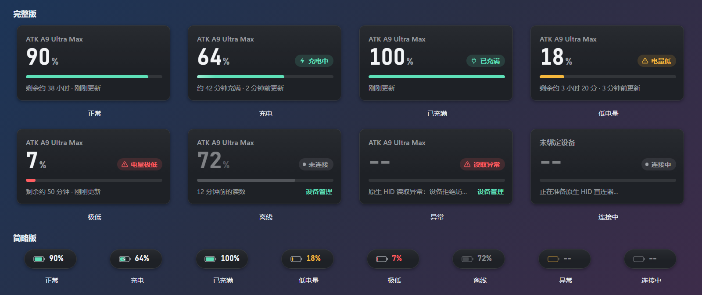
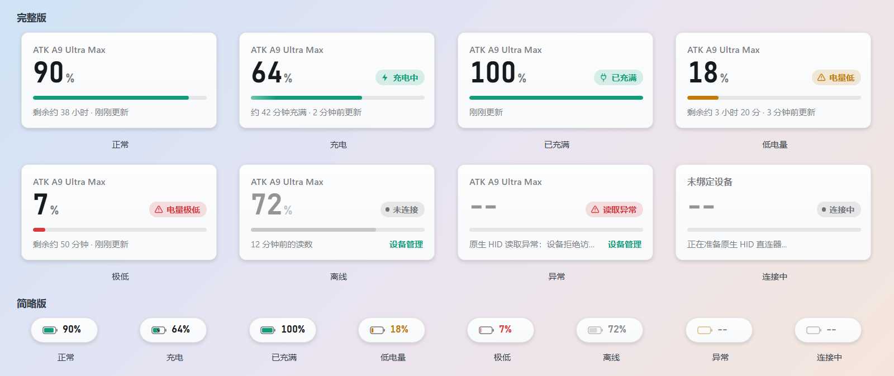
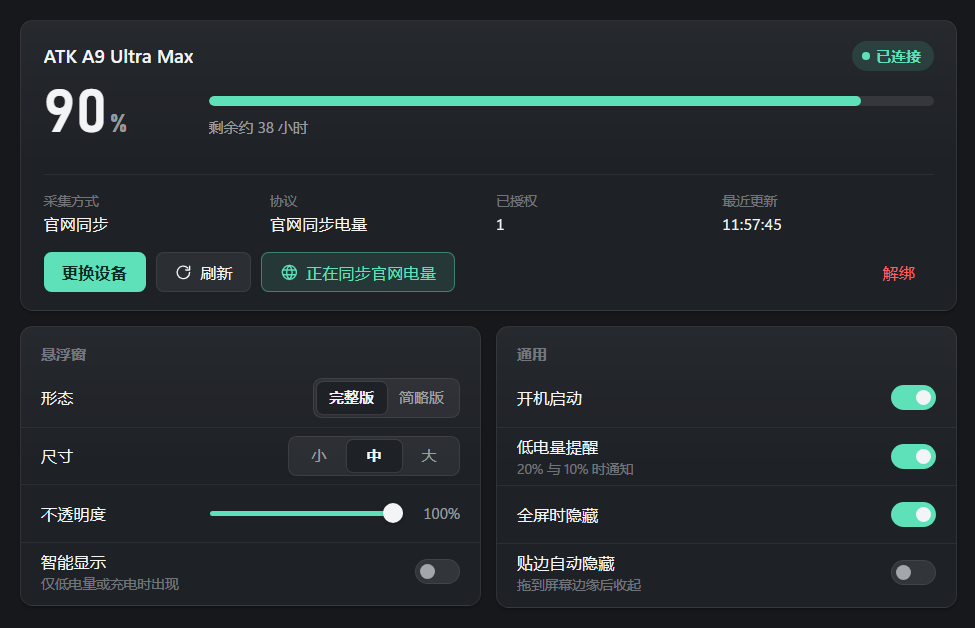
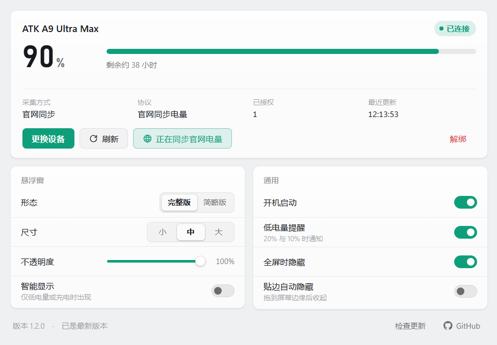

# ATK 电量悬浮窗

在 Windows 11 桌面上常驻显示 ATK / VXE 鼠标电量。

Rust 原生读取 HID 协议，界面跑在系统 WebView2 上，安装包不携带 Chromium 或 Node.js 运行时。

## 界面

### 悬浮窗

完整版卡片与简略版胶囊覆盖全部 8 种状态，深浅色跟随系统。



<details>
<summary>浅色主题</summary>
<br />

</details>

### 设备管理

<table>
  <tr>
    <td></td>
    <td></td>
  </tr>
</table>

## 功能

**悬浮窗**

- 完整版卡片显示设备名、电量、状态和续航；简略版胶囊只保留电池图标与百分比
- 电量色阶：20% 以下转为琥珀色，10% 以下转为红色；充电时进度条持续流光，新读数到达时卡片扫过一道浅光
- 断连后保留最后一次读数，以灰显的离线态展示
- 续航估算：放电满 30 分钟且下降 3% 后显示剩余时间，充电满 5 分钟且上升 2% 后显示充满时间
- 尺寸（小 / 中 / 大）与不透明度（40%–100%）可调，指针悬停时恢复完全不透明

**窗口行为**

- 两种形态分别记忆位置；拖近屏幕边缘自动吸附，拖出左、右、上边缘时拉回贴边
- 贴边自动隐藏：贴边后指针离开 0.8 秒，窗口滑入屏幕外只留一道细边，指针移到细边上即滑回；动画按显示器刷新率逐帧绘制
- 全屏游戏或演示时自动隐藏，退出后恢复
- 智能显示：只在电量不高于 20% 或充电时出现
- 原位置所在屏幕断开后回到主屏，托盘菜单可一键重置位置

**设备与电量**

- COMPX / HECHI 双协议自动探测与降级
- 设备选择、绑定、更换与自动复连；订阅 HID 插拔通知即时重扫，休眠恢复后自动重连
- 低电量在 20% 与 10% 各发送一次系统通知，充电后重新计数
- ATK HUB 官网同步作为未适配型号的备用来源，开启后跨重启保持
- 启动后自动检查 GitHub 新版本，发现后通过托盘菜单与系统通知提醒
- 托盘图标实时绘制电量数字（满电显示 `F`）

## 操作

| 位置 | 操作 | 效果 |
| --- | --- | --- |
| 悬浮窗 | 拖动 | 移动窗口，松手后吸附到附近边缘 |
| 悬浮窗 | 双击 | 在完整版与简略版之间切换 |
| 悬浮窗 | 右键 / `⋯` 按钮 | 保持置顶、锁定位置、简略模式、立即刷新、打开设备管理、隐藏悬浮窗 |
| 托盘图标 | 右键 | 显示或隐藏悬浮窗、重置位置、打开设备管理、刷新、开机启动、退出 |
| 设备管理 | — | 绑定或更换设备、切换官网同步，以及全部外观与行为设置 |
| 设备管理页脚 | 检查更新 / 更新到指定版本 / GitHub | 手动检查、打开发布页或项目主页 |

## 电量来源

同一时刻只有一种来源生效。

**本地 HID 直连**（默认）：Rust 工作线程直接读取 COMPX 或 HECHI 协议。设备身份包含 VID、PID、产品名和接口签名，接口签名变化时按同产品降级匹配。

**官网同步**：由后台 WebView 窗口从 `hub.atk.pro` 采集。关闭窗口只是隐藏，同步继续运行。手动关闭、绑定新设备或解绑设备时退出同步模式。

轮询节奏随场景调整：悬浮窗可见时每 10 秒一次；接线（充电或已充满）时可见 5 秒、隐藏 15 秒；隐藏且未接线时按电量放宽到 2、5 或 10 分钟。插拔事件后在 1、3、6 秒补读，直到充电状态翻转。

## 开发

**环境**：Windows 11、Node.js 18+、Rust stable（MSVC）、Visual Studio Build Tools（C++ 桌面开发）、WebView2 Runtime。

Rust 工具链可以装在非系统盘，npm 脚本会读取用户环境变量中的 `CARGO_HOME` 与 `RUSTUP_HOME`，无需重开终端。

```powershell
npm install
npm start                    # Tauri 开发版本
npm run check                # 语法检查、桥接测试、Rust 单元测试
npm run build:win:unpacked   # 仅编译 release 可执行文件，输出到 dist/
npm run build:win            # NSIS 安装包，输出到 dist/
npm run docs:screenshots     # 用无头 Edge 重新生成 README 截图
```

release 构建启用 LTO、`opt-level = "z"`、单 codegen unit、panic abort 与符号剥离；安装包复用系统 WebView2，不内置运行时。

## 项目结构

```text
.
├─ assets/screenshots/          # README 截图，由 docs:screenshots 生成
├─ docs/                        # 长期工程约束
├─ scripts/                     # 语法检查、截图、图标生成与 Rust 工具启动
├─ src/renderer/
│  ├─ runtime-bridge.js         # Tauri command / event 到渲染层 API 的映射
│  ├─ battery-view.js           # 悬浮窗与管理页共用的电量阈值与文案
│  ├─ hid-shared.js             # 设备命名与排序
│  ├─ overlay.*                 # 悬浮窗
│  └─ manager.* / manager/      # 设备管理页
├─ src-tauri/
│  ├─ capabilities/             # Tauri 权限边界
│  ├─ scripts/                  # ATK HUB 只读采集脚本
│  └─ src/
│     ├─ battery_service.rs     # HID 工作线程、轮询、退避与状态广播
│     ├─ battery_trend.rs       # 续航估算与低电量提醒
│     ├─ device.rs / protocol.rs # HID 枚举、设备身份与 COMPX / HECHI 协议
│     ├─ commands.rs            # 前端命令边界与悬浮窗原生菜单
│     ├─ hub.rs / hub_permissions.rs # 官网同步窗口与 WebHID 授权导入
│     ├─ overlay_edge.rs        # 贴边吸附、自动隐藏与逐帧动画
│     ├─ overlay_behavior.rs    # 全屏隐藏与智能显示
│     ├─ state.rs               # 设置持久化与运行状态
│     ├─ system_tray.rs / tray_text.rs # 托盘菜单与 GDI 电量图标
│     ├─ window_manager.rs      # 窗口生命周期与位置记忆
│     └─ windows_integration.rs # 设备插拔、电源与全屏状态消息
└─ test/                        # 渲染层桥接测试
```

## 数据与安全

- 配置保存在 Tauri 应用配置目录的 `settings.json`，首次启动兼容读取旧版 `%APPDATA%\atktool\settings.json`。
- 官网同步窗口只允许导航到 `https://hub.atk.pro/`；回传的状态必须来自该窗口与来源且同步处于开启状态，Rust 侧校验文本长度、电量范围和状态枚举后才接受。
- 渲染层通过 capability 白名单访问命令，本地窗口与 HUB 窗口的命令集互不重叠。

## 已知限制

- 只支持已适配的协议，其他型号显示「待适配」，可改用官网同步。
- 蓝牙模式通常无法稳定读取，请使用 2.4G 接收器或有线连接。
- 官网同步依赖 hub.atk.pro 的页面结构，官网改版后可能需要更新采集规则。
- 托盘电量数字依赖 Windows GDI 与 Bahnschrift 字体。

## License

ISC
